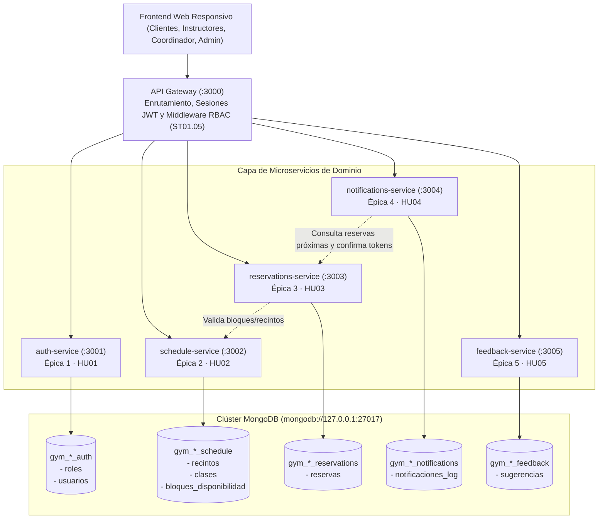
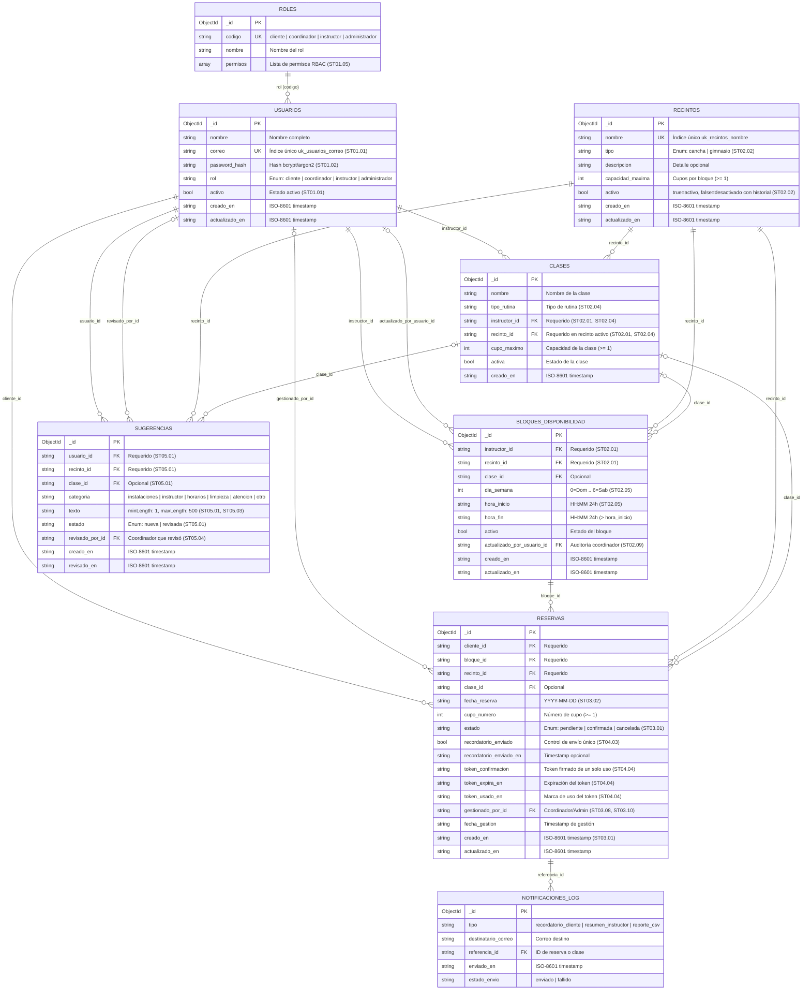

# Modelo de Datos en MongoDB y Arquitectura de Microservicios (`TR.03`)

**Proyecto:** Sistema de Reserva para Gimnasio y Canchas  
**Subtarea:** `TR.03` · Diseñar el modelo de datos completo (`usuarios`, `roles`, `recintos`, `clases`, `bloques_disponibilidad`, `reservas`, `sugerencias`) bajo un esquema de **Microservicios con MongoDB**.  
**Estado:** Revisado contra las historias de usuario `HU01` a `HU05`.

---

## 1. Arquitectura de Microservicios y Bases de Datos MongoDB

Cada épica del sistema está desacoplada en su propio microservicio de dominio siguiendo el patrón **Database-per-Service** sobre el clúster de MongoDB:



---

## 2. Diagrama Entidad-Relación de Colecciones MongoDB (`TR.03`)

Aunque cada microservicio gestiona su propia base de datos lógica en MongoDB, las colecciones mantienen integridad de dominio mediante referencias de `ObjectId` (`_id`) y validadores nativos `$jsonSchema`:



---

## 3. Reglas de Integridad en MongoDB (`$jsonSchema` e Índices)

Todas las reglas están implementadas en [001_mongodb_schemas_and_indexes.js](../database/migrations/001_mongodb_schemas_and_indexes.js):

1. **Correo único de usuario (`ST01.01`):**
   - Índice único `{ correo: 1 }` (`unique: true`) en `gym_*_auth.usuarios`, rechazando correos duplicados con error `E11000 duplicate key error` a nivel de base de datos.
2. **Bloques con instructor y recinto obligatorios (`ST02.01`):**
   - Validador `$jsonSchema` en `gym_*_schedule.bloques_disponibilidad` con `required: ['instructor_id', 'recinto_id', 'dia_semana', 'hora_inicio', 'hora_fin', 'activo', 'creado_en']`.
3. **Estados de reserva restringidos (`ST03.01`):**
   - Validador `$jsonSchema` en `gym_*_reservations.reservas` con `enum: ['pendiente', 'confirmada', 'cancelada']`. Cualquier otro estado es rechazado con error `Document failed validation (code 121)`.
4. **Restricción única contra reservas duplicadas sobre el mismo cupo y fecha (`ST03.02`):**
   - Índice único con expresión de filtro parcial (`partialFilterExpression`) en MongoDB:
     ```javascript
     db.collection('reservas').createIndex(
       { bloque_id: 1, fecha_reserva: 1, cupo_numero: 1 },
       {
         unique: true,
         name: 'uk_reserva_cupo_fecha_activa',
         partialFilterExpression: {
           estado: { $in: ['pendiente', 'confirmada'] }
         }
       }
     );
     ```
   - Permite conservar el historial de reservas con `estado: 'cancelada'` (`ST03.06`) mientras impide a nivel de base de datos insertar una segunda reserva activa para el mismo bloque, fecha y cupo.
5. **Límite de caracteres y estados en sugerencias (`ST05.01`, `ST05.03`):**
   - Validador `$jsonSchema` en `gym_*_feedback.sugerencias` con `texto: { bsonType: 'string', minLength: 1, maxLength: 500 }` y `estado: { enum: ['nueva', 'revisada'] }`.

---

## 4. Matriz de Trazabilidad por Microservicio (`HU01` – `HU05`)

| Historia | Microservicio Responsable | Base de Datos MongoDB | Colecciones | Subtareas Cubiertas |
| :--- | :--- | :--- | :--- | :--- |
| **`HU01`** | `auth-service` (`:3001`) | `gym_*_auth` | `roles`, `usuarios` | `ST01.01` – `ST01.08` |
| **`HU02`** | `schedule-service` (`:3002`) | `gym_*_schedule` | `recintos`, `clases`, `bloques_disponibilidad` | `ST02.01` – `ST02.11` |
| **`HU03`** | `reservations-service` (`:3003`) | `gym_*_reservations` | `reservas` | `ST03.01` – `ST03.11` |
| **`HU04`** | `notifications-service` (`:3004`) | `gym_*_notifications` | `notificaciones_log` (+ `reservas`) | `ST04.01` – `ST04.08` |
| **`HU05`** | `feedback-service` (`:3005`) | `gym_*_feedback` | `sugerencias` | `ST05.01` – `ST05.07` |
