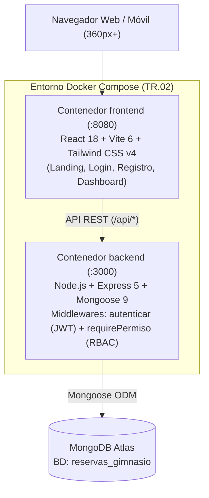
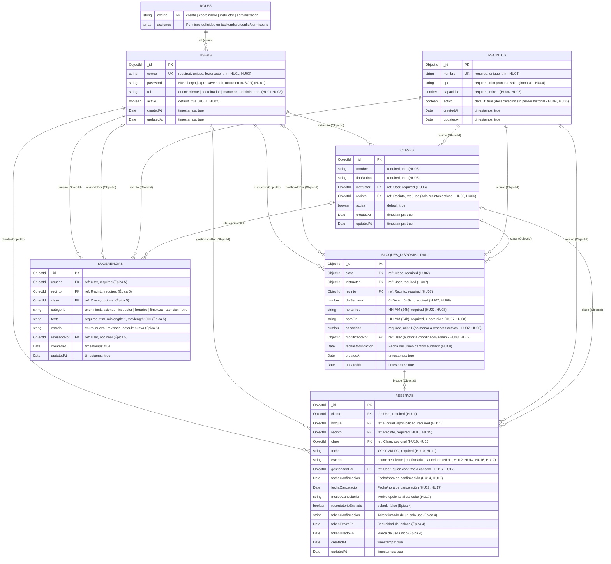

# Modelo Entidad-Relación y Arquitectura de Datos (`TR.03`)

**Proyecto:** Sistema de Reserva para Gimnasio y Canchas  
**Subtarea:** `TR.03` · Diseñar el modelo entidad-relación completo (`usuarios`, `roles`, `recintos`, `clases`, `bloques_disponibilidad`, `reservas`, `sugerencias`), revisado contra las Historias de Usuario **`HU01` a `HU17`** y las Épicas 1 a 5.  
**Stack Oficial del Proyecto:**
- **Frontend (`frontend/`):** React 18 + Vite 6 + Tailwind CSS v4 (Nginx en puerto `8080` / Vite en `5173`).
- **Backend (`backend/`):** Node.js + Express 5 + Mongoose 9 + JWT + `bcryptjs` (API REST en puerto `3000`).
- **Base de Datos:** MongoDB Atlas (BD `reservas_gimnasio`; URI `mongodb+srv` configurada en `backend/.env`).

---

## 1. Diagrama de Arquitectura de Contenedores y Módulos



---

## 2. Diagrama Entidad-Relación de Modelos Mongoose / MongoDB (`TR.03`)

El modelo de datos cubre íntegramente las historias **`HU01` a `HU17`** (Épicas 1 a 3) más las Épicas 4 y 5 mediante colecciones en MongoDB (`reservas_gimnasio`):



---

## 3. Reglas de Integridad y Restricciones por Historia (`HU01` – `HU17`)

### 3.1. Épica 1 · Autenticación y Usuarios (`HU01` – `HU03` · Sprint 1)
- **Modelo implementado:** [backend/src/models/User.js](../backend/src/models/User.js) y matriz RBAC en [backend/src/config/permisos.js](../backend/src/config/permisos.js).
- **`HU01` (Registro de cliente):** Correo único (`unique: true` -> `409` en duplicado), contraseña `>= 8` caracteres cifrada con `bcryptjs` en hook `pre('save')` y oculta en `toJSON`, cuenta creada activa con `rol: 'cliente'` y respuesta `201` con `{ usuario, token }`.
- **`HU02` (Inicio de sesión):** Valida cuenta activa y contraseña (`401` con mensaje genérico si falla), emite JWT con caducidad configurable (`JWT_EXPIRES_IN`, `2h` por defecto) y recupera sesión en React (`GET /api/auth/perfil`).
- **`HU03` (Creación de usuarios e instructores por administrador):** Ruta `POST /api/usuarios` exclusiva para `administrador` (`403` para otros roles), valida rol dentro de `['cliente', 'coordinador', 'instructor', 'administrador']` (`400` con opciones permitidas si es inválido) y rechaza correos duplicados con `409`.

### 3.2. Épica 2 · Gestión de Recintos y Horarios (`HU04` – `HU09` · Sprint 2)
- **`HU04` y `HU05` (`Recinto`):** Nombre único (`409` si se repite), `tipo` y `capacidad > 0` obligatorios. Soporta desactivación (`activo: false`) para excluir el recinto de nuevas clases y consultas de disponibilidad mientras conserva el historial de clases y reservas.
- **`HU06` (`Clase`):** Vinculada al instructor autenticado (`instructor`) y a un recinto activo (`recinto`).
- **`HU07`, `HU08` y `HU09` (`BloqueDisponibilidad`):**
  - Vinculado a `clase`, `instructor` y `recinto`, con `diaSemana`, `horaInicio`, `horaFin` (`horaFin > horaInicio`) y `capacidad > 0` que no puede superar la `capacidad` del recinto asignado.
  - Validación de no solapamiento para el mismo `instructor` y `diaSemana`.
  - En actualizaciones (`HU08`, `HU09`), no se permite reducir `capacidad` por debajo del número de reservas activas ni eliminar bloques con reservas activas, registrando `modificadoPor` y `fechaModificacion` (`updatedAt`).

### 3.3. Épica 3 · Reservas (`HU10` – `HU17` · Sprint 3)
- **`HU10` (Consultar disponibilidad):** Calcula `cuposLibres = bloque.capacidad - reservasActivas` filtrando por fecha, recinto activo, clase e instructor.
- **`HU11` (Reservar un cupo):**
  - Nace en `estado: 'pendiente'`.
  - Índice único parcial en MongoDB para impedir que el mismo cliente duplique una reserva activa en el mismo bloque y fecha (`409`):
    ```javascript
    reservaSchema.index(
      { bloque: 1, fecha: 1, cliente: 1 },
      {
        unique: true,
        partialFilterExpression: { estado: { $in: ['pendiente', 'confirmada'] } }
      }
    );
    ```
  - Control de concurrencia verificando que las reservas activas (`pendiente` o `confirmada`) no superen `bloque.capacidad` (`409` si el bloque está lleno).
- **`HU12` y `HU17` (Cancelación por cliente o coordinador):** Cambia `estado` a `'cancelada'`, libera el cupo y conserva el registro en el historial con `fechaCancelacion`, `gestionadoPor` y `motivoCancelacion` opcional.
- **`HU14` y `HU16` (Confirmación por cliente o coordinador):** Cambia `estado` de `'pendiente'` a `'confirmada'` (para el cliente, hasta 1 hora antes del inicio del bloque, de forma idempotente), registrando `fechaConfirmacion` y `gestionadoPor`.

---

## 4. Matriz de Trazabilidad Completa

| Sprint | Épica | Historias de Usuario | Modelos / Colecciones |
| :--- | :--- | :--- | :--- |
| **Sprint 1** | Transversal + Épica 1 | `TR.01`–`TR.04`, `HU01`, `HU02`, `HU03` | `User` (`users`), `PERMISOS` |
| **Sprint 2** | Épica 2 · Recintos y Horarios | `HU04`, `HU05`, `HU06`, `HU07`, `HU08`, `HU09` | `Recinto`, `Clase`, `BloqueDisponibilidad` |
| **Sprint 3** | Épica 3 · Reservas | `HU10`, `HU11`, `HU12`, `HU13`, `HU14`, `HU15`, `HU16`, `HU17` | `Reserva`, `BloqueDisponibilidad`, `Recinto` |
| **Sprint 4** | Épicas 4 y 5 | Notificaciones y Sugerencias / Indicadores | `Reserva` (`recordatorioEnviado`, `token*`), `Sugerencia` |
