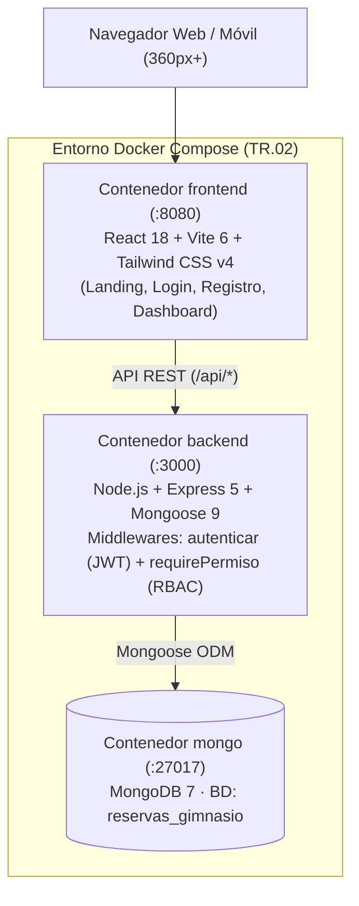
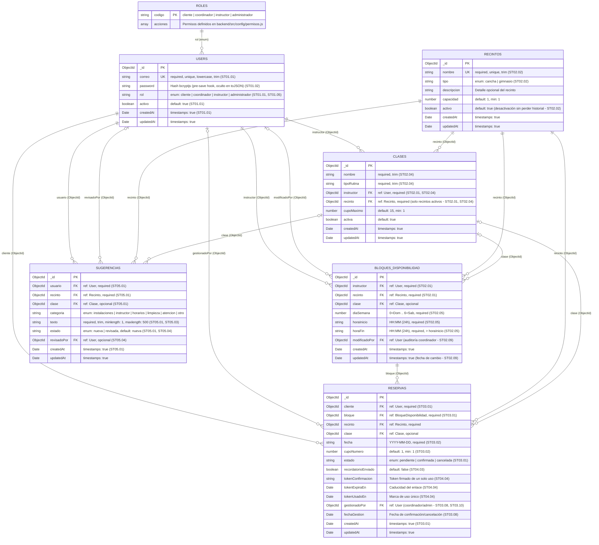

# Modelo Entidad-Relación y Arquitectura de Datos (`TR.03`)

**Proyecto:** Sistema de Reserva para Gimnasio y Canchas  
**Subtarea:** `TR.03` · Diseñar el modelo entidad-relación completo (`usuarios`, `roles`, `recintos`, `clases`, `bloques_disponibilidad`, `reservas`, `sugerencias`).  
**Stack Oficial del Proyecto:**
- **Frontend (`frontend/`):** React 18 + Vite 6 + Tailwind CSS v4 (Nginx en puerto `8080` / Vite en `5173`).
- **Backend (`backend/`):** Node.js + Express 5 + Mongoose 9 + JWT + `bcryptjs` (API REST en puerto `3000`).
- **Base de Datos (`mongo`):** MongoDB 7 (`mongodb://mongo:27017/reservas_gimnasio`).

---

## 1. Diagrama de Arquitectura de Contenedores y Módulos



---

## 2. Diagrama Entidad-Relación de Modelos Mongoose / MongoDB (`TR.03`)

El modelo de datos cubre íntegramente las historias de usuario **`HU01` a `HU05`** mediante colecciones en MongoDB (`reservas_gimnasio`) con referencias `ObjectId` y validaciones tanto en Mongoose como a nivel de índices de base de datos:



---

## 3. Reglas de Integridad y Restricciones por Historia (`HU01` – `HU05`)

### 3.1. Épica 1 · Autenticación y Usuarios (`HU01`)
- **Modelo implementado:** [backend/src/models/User.js](../backend/src/models/User.js) y matriz RBAC en [backend/src/config/permisos.js](../backend/src/config/permisos.js).
- **`ST01.01`:** Correo único (`unique: true, lowercase: true, trim: true`), rol restringido a `['cliente', 'coordinador', 'instructor', 'administrador']`, estado `activo: Boolean` y fechas automáticas (`timestamps: true`).
- **`ST01.02`:** Cifrado con `bcryptjs` en hook `pre('save')` y eliminación automática de `password` en `toJSON`.

### 3.2. Épica 2 · Gestión de Recintos y Horarios (`HU02`)
- **`ST02.01`:** `BloqueDisponibilidad` exige referencias obligatorias `instructor` (`ref: 'User'`, `required: true`) y `recinto` (`ref: 'Recinto'`, `required: true`).
- **`ST02.02`:** `Recinto` utiliza borrado lógico (`activo: Boolean, default: true`) para que al desactivarse deje de aparecer en consultas de clientes sin perder el historial de reservas ni sugerencias.
- **`ST02.05` y `ST02.06`:** Validación de `horaFin > horaInicio` y verificación en controlador/modelo para impedir que un mismo `instructor` registre bloques que se solapen en el mismo `diaSemana`.
- **`ST02.07`:** Antes de eliminar un `BloqueDisponibilidad`, se verifica en `Reserva` que no existan reservas con `estado: { $in: ['pendiente', 'confirmada'] }`.
- **`ST02.09`:** `modificadoPor` (`ref: 'User'`) y `updatedAt` registran los cambios realizados por el coordinador.

### 3.3. Épica 3 · Reservas (`HU03`)
- **`ST03.01`:** Campo `estado` restringido por `enum: ['pendiente', 'confirmada', 'cancelada']` con valor inicial `'pendiente'`.
- **`ST03.02` (Restricción única contra reservas duplicadas):**
  Índice único parcial en MongoDB/Mongoose sobre reservas activas:
  ```javascript
  reservaSchema.index(
    { bloque: 1, fecha: 1, cupoNumero: 1 },
    {
      unique: true,
      partialFilterExpression: { estado: { $in: ['pendiente', 'confirmada'] } }
    }
  );
  ```
  Esto rechaza a nivel de base de datos (`code: 11000`) cualquier intento de duplicar una reserva activa sobre el mismo cupo y fecha, pero permite volver a reservar ese horario si la reserva previa pasa a `'cancelada'` (`ST03.06`).

### 3.4. Épica 4 · Notificaciones y Reportes (`HU04`)
- **`ST04.03`:** Booleano `recordatorioEnviado: { type: Boolean, default: false }` en `Reserva` para garantizar que el job programado (`ST04.02`) envíe como máximo un recordatorio por reserva.
- **`ST04.04`:** Campos `tokenConfirmacion`, `tokenExpiraEn` y `tokenUsadoEn` para validar enlaces de confirmación firmados, con caducidad y de un solo uso.

### 3.5. Épica 5 · Sugerencias e Indicadores (`HU05`)
- **`ST05.01` y `ST05.03`:** Colección `Sugerencia` con `usuario` (`required`), `recinto` (`required`), `clase` (opcional), `categoria`, `texto` (`required, minlength: 1, maxlength: 500`) y `estado` (`enum: ['nueva', 'revisada'], default: 'nueva'`).
- **`ST05.05`:** Índices sobre `{ recinto: 1, categoria: 1, createdAt: 1 }` y `{ clase: 1, createdAt: 1 }` para agregaciones rápidas (`Reserva.aggregate` / `Sugerencia.aggregate`) en el panel de indicadores del administrador.

---

## 4. Matriz de Trazabilidad del Modelo E-R (`HU01` – `HU05`)

| Historia | Subtareas Cubiertas | Modelos Mongoose / Colecciones MongoDB |
| :--- | :--- | :--- |
| **`HU01`** | `ST01.01`, `ST01.02`, `ST01.03`, `ST01.05`, `ST01.07` | `User` (`users`), `PERMISOS` (`config/permisos.js`) |
| **`HU02`** | `ST02.01`, `ST02.02`, `ST02.04`, `ST02.05`, `ST02.06`, `ST02.07`, `ST02.09` | `Recinto` (`recintos`), `Clase` (`clases`), `BloqueDisponibilidad` (`bloques`) |
| **`HU03`** | `ST03.01`, `ST03.02`, `ST03.03`, `ST03.05`, `ST03.06`, `ST03.08`, `ST03.10` | `Reserva` (`reservas`), `BloqueDisponibilidad`, `Recinto` |
| **`HU04`** | `ST04.02`, `ST04.03`, `ST04.04`, `ST04.06`, `ST04.07` | `Reserva` (`recordatorioEnviado`, `tokenConfirmacion`, `tokenExpiraEn`, `tokenUsadoEn`) |
| **`HU05`** | `ST05.01`, `ST05.03`, `ST05.04`, `ST05.05` | `Sugerencia` (`sugerencias`) |
