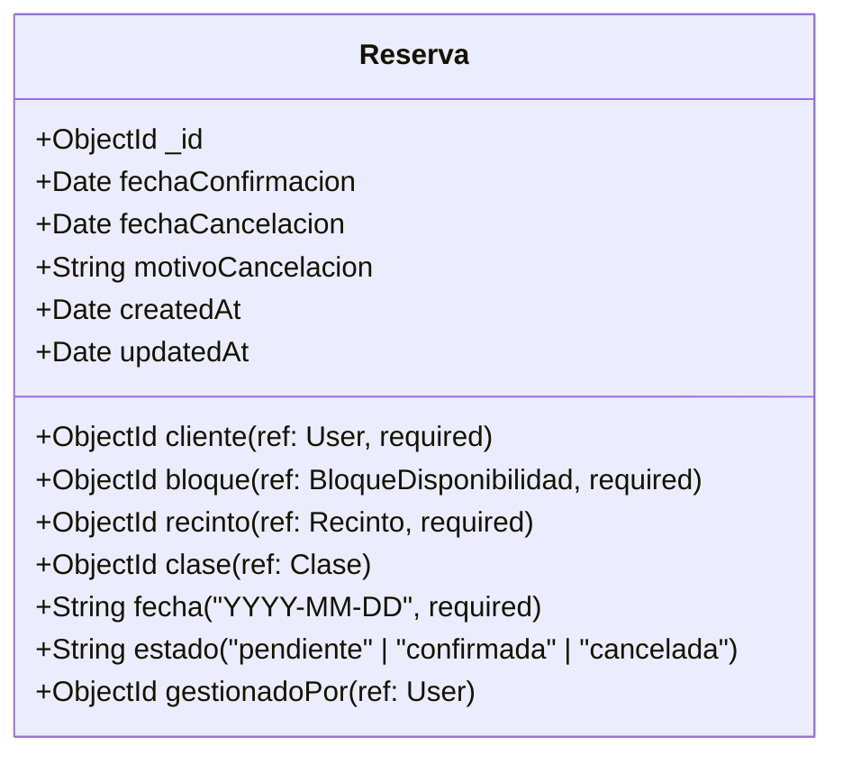

# Plan Detallado del Sprint 3 · Épica 3: Reservas (`HU10` – `HU17` / `ST03.01` – `ST03.11`)

**Proyecto:** Sistema de Reserva para Gimnasio y Canchas  
**Sprint:** Sprint 3  
**Épica:** Épica 3 · Consulta, reserva, confirmación y control de cupos  
**Rama de trabajo sugerida:** `feature/HU03-sprint3-reservas`

---

## 1. Objetivo del Sprint 3

Habilitar el ciclo completo de reservas en la plataforma para los cuatro roles del sistema:
1. **Cliente:** Buscar horarios con cupos libres por fecha, recinto, clase e instructor (`HU10`), reservar su cupo en estado `pendiente` (`HU11`), consultar sus reservas pasadas y próximas (`HU13`), confirmar su asistencia hasta 1 hora antes (`HU14`) o cancelar su reserva para liberar el cupo (`HU12`).
2. **Instructor:** Consultar en su panel cuántas personas han reservado y cuántas han confirmado asistencia en cada una de sus clases y bloques horarios (`ST03.09`).
3. **Coordinador:** Supervisar todas las reservas con filtros por fecha, recinto, clase, instructor y estado (`HU15`), confirmar reservas pendientes (`HU16`) y cancelar reservas no confirmadas indicando motivo opcional para liberar el cupo a tiempo (`HU17`).
4. **Administrador:** Ejercer todas las funciones de gestión de reservas del coordinador más la capacidad de editar y reasignar reservas (`ST03.10`).

---

## 2. Mapa de Historias de Usuario y Subtareas del Sprint 3

| ID Subtarea | Historia (`HU`) | Área | Descripción Técnica | Criterio de Terminado (DoD) |
| :--- | :--- | :--- | :--- | :--- |
| **`ST03.01`** | `HU11` | BD | Esquema `Reserva` con estados `pendiente`, `confirmada` y `cancelada`, auditoría y fechas. | Estados restringidos a los 3 valores permitidos por la base de datos. |
| **`ST03.02`** | `HU11` | BD | Restricción única parcial para impedir reservas activas duplicadas sobre el mismo bloque, fecha y cliente/cupo. | Insertar una segunda reserva activa duplicada falla a nivel de base de datos (`code: 11000`). |
| **`ST03.03`** | `HU10` | Backend | Endpoint de disponibilidad por fecha, recinto, clase e instructor que devuelve solo bloques con cupo libre. | Solo muestra recintos activos y bloques futuros con `cuposLibres > 0`. |
| **`ST03.04`** | `HU10`, `HU13` | Frontend | Pantalla del cliente con buscador de disponibilidad (calendario/fecha y filtros) y pestaña «Mis reservas». | El cliente filtra por fecha y recinto, ve solo horarios con cupos libres y consulta sus reservas. |
| **`ST03.05`** | `HU11` | Backend | Endpoint para reservar un cupo validando capacidad y concurrencia antes de guardar. | Dos solicitudes simultáneas para el último cupo: solo una queda guardada; reserva válida devuelve `201`. |
| **`ST03.06`** | `HU12`, `HU14` | Backend | Endpoints del cliente para cancelar reserva propia (antes del inicio) y confirmar asistencia (hasta 1h antes). | El cliente no puede modificar reservas ajenas (`403`); al cancelar se conserva el registro y se libera el cupo. |
| **`ST03.07`** | `HU15` | Frontend | Panel del coordinador con listado de reservas filtrable por fecha, recinto, clase, instructor y estado. | Las reservas se muestran con correo del cliente, horario, recinto, clase y estado ordenadas por fecha/hora. |
| **`ST03.08`** | `HU16`, `HU17` | Backend | Endpoints del coordinador/administrador para confirmar reservas pendientes o cancelar reservas con motivo opcional. | Cada acción cambia el estado, libera el cupo si cancela y registra `gestionadoPor` y fecha. |
| **`ST03.09`** | `HU03` (v2) | Frontend / Backend | Vista del instructor con el conteo de reservas totales, pendientes y confirmadas por clase y horario. | Los conteos se actualizan inmediatamente después de reservar, confirmar o cancelar. |
| **`ST03.10`** | `HU03` (v2) | Backend / Frontend | Extensión para el administrador: ver todas las reservas, editar y reasignar (bloque/cliente). | El administrador realiza las acciones del coordinador y además puede reasignar reservas. |
| **`ST03.11`** | `HU10`–`HU17` | Pruebas | Suite de pruebas automatizadas y prueba E2E del ciclo completo: reservar → confirmar → cancelar → cupo libre. | Todos los casos y el flujo E2E pasan en verde en Jest + Supertest. |

---

## 3. Diseño Técnico de lo que Vamos a Construir

### 3.1. Capa de Base de Datos (`backend/src/models/Reserva.js`)

- **Índices en MongoDB:**
  1. `uk_reserva_cliente_bloque_fecha_activa`: Índice único sobre `{ bloque: 1, fecha: 1, cliente: 1 }` con `partialFilterExpression: { estado: { $in: ['pendiente', 'confirmada'] } }`.
  2. `idx_reservas_ocupacion`: Índice sobre `{ bloque: 1, fecha: 1, estado: 1 }` para el cálculo instantáneo de cupos ocupados.
  3. `idx_reservas_filtros_coordinador`: Índice sobre `{ fecha: 1, recinto: 1, estado: 1 }`.

---

### 3.2. Capa de Backend (`backend/src/controllers/reservas.controller.js` y `routes/reservas.routes.js`)

| Método | Endpoint | Historia / Subtarea | Roles Permitidos | Comportamiento y Reglas de Negocio |
| :--- | :--- | :--- | :--- | :--- |
| `GET` | `/api/reservas/disponibilidad` | `HU10`, `ST03.03` | `cliente`, `coordinador`, `instructor`, `administrador` | Recibe `?fecha=YYYY-MM-DD` (y opcionalmente `recinto`, `clase`, `instructor`). Determina el `diaSemana` (`0..6`) de la fecha, busca bloques en recintos activos, calcula `cuposLibres = bloque.capacidad - reservasActivasEnFecha` y devuelve solo los bloques con `cuposLibres > 0`. |
| `POST` | `/api/reservas` | `HU11`, `ST03.05` | `cliente` | Recibe `{ bloqueId, fecha }`. Verifica con control de concurrencia que el recinto esté activo, que la fecha/hora sea futura, que el cliente no tenga ya una reserva activa en ese bloque y fecha (`409`), y que `reservasActivas < bloque.capacidad` (`409` si está lleno). Crea la reserva en `estado: 'pendiente'` (`201`). |
| `GET` | `/api/reservas/mias` | `HU13` | `cliente` | Lista únicamente las reservas del cliente autenticado (`req.user.id`) pobladas con `recinto`, `clase`, `bloque` e `instructor`. Soporta filtro `?tipo=proximas` o `?tipo=pasadas`. |
| `PATCH` | `/api/reservas/:id/confirmar-asistencia` | `HU14` | `cliente` (propietario) | Confirma una reserva propia en estado `pendiente` (idempotente si ya estaba `confirmada`). Valida que falte al menos **1 hora** antes del inicio del bloque (`409`/`400` si ya pasó la ventana límite). |
| `PATCH` | `/api/reservas/:id/cancelar-propia` | `HU12`, `ST03.06` | `cliente` (propietario) | Verifica que `reserva.cliente === req.user.id` (`403` si es de otro usuario) y que el bloque aún no haya iniciado. Cambia `estado` a `'cancelada'`, guarda `fechaCancelacion` y libera el cupo. |
| `GET` | `/api/reservas` | `HU15`, `ST03.07` | `coordinador`, `administrador` | Lista todas las reservas del sistema con filtros combinados (`?fecha=`, `?recinto=`, `?clase=`, `?instructor=`, `?estado=`), ordenadas por fecha y hora de inicio, sin exponer hashes de contraseña. |
| `PATCH` | `/api/reservas/:id/confirmar` | `HU16`, `ST03.08` | `coordinador`, `administrador` | Confirma cualquier reserva en estado `pendiente` (rechaza con `409` si está `cancelada`). Registra `gestionadoPor = req.user.id` y `fechaConfirmacion = new Date()`. |
| `PATCH` | `/api/reservas/:id/cancelar` | `HU17`, `ST03.08` | `coordinador`, `administrador` | Cancela una reserva `pendiente` o `confirmada` (rechaza con `409` si ya estaba `cancelada`). Registra `gestionadoPor = req.user.id`, `fechaCancelacion = new Date()` y `motivoCancelacion` opcional, liberando el cupo. |
| `PATCH` | `/api/reservas/:id/reasignar` | `ST03.10` | `administrador` | Permite al administrador reasignar una reserva a otro bloque, fecha o cliente validando disponibilidad en el destino y dejando registro de auditoría en `gestionadoPor`. |
| `GET` | `/api/reservas/conteo-instructor` | `ST03.09` | `instructor`, `coordinador`, `administrador` | Devuelve por cada bloque del instructor (y fecha opcional, incluso pasada) el conteo de reservas `pendientes`, `confirmadas`, `canceladas`, `cuposLibres` y el detalle de clientes agrupado por estado. |

---

### 3.3. Capa de Frontend (`frontend/src/api.js` y `frontend/src/pages/Dashboard.jsx`)

1. **Cliente HTTP (`frontend/src/api.js`):**
   - Nuevo módulo `reservasApi` con métodos: `disponibilidad(filtros)`, `crear({ bloqueId, fecha })`, `mias(tipo)`, `confirmarAsistencia(id)`, `cancelarPropia(id)`, `listarTodas(filtros)`, `confirmarCoordinador(id)`, `cancelarCoordinador(id, motivo)`, `reasignarAdmin(id, datos)`, `conteoInstructor(filtros)`.
2. **Vista del Cliente (`ST03.04`, `HU10`–`HU14`):**
   - **Sección 1 · Buscar Disponibilidad y Reservar (`HU10`, `HU11`):**
     - Selector de fecha (`input type="date"`, por defecto hoy/mañana), filtro de recinto activo y filtro de clase.
     - Tarjetas/tabla de horarios disponibles mostrando: Clase, Recinto, Instructor, Horario (`horaInicio – horaFin`), badge de **Cupos libres (`X de Y disponibles`)** y botón **«Reservar cupo»**.
   - **Sección 2 · Mis Reservas (`HU12`, `HU13`, `HU14`):**
     - Pestañas de filtro: **Próximas** | **Pasadas** | **Todas**.
     - Estado visual por colores (`pendiente` en ámbar, `confirmada` en verde esmeralda, `cancelada` en gris/rojo).
     - Botón **«Confirmar asistencia»** (para reservas pendientes dentro del límite de 1h antes) y botón **«Cancelar reserva»** (para reservas próximas activas).
3. **Vista del Coordinador (`ST03.07`, `HU15`–`HU17`):**
   - **Panel de Control de Reservas:**
     - Barra de filtros combinados: Fecha, Recinto, Estado (`Todos`, `Pendiente`, `Confirmada`, `Cancelada`).
     - Tabla con Cliente (`correo`), Fecha, Horario, Recinto, Clase, Instructor, Estado y Auditoría (`gestionadoPor`).
     - Botones de acción en cada fila: **«Confirmar»** (`HU16`) y **«Cancelar / Liberar cupo»** con campo opcional de motivo (`HU17`).
4. **Vista del Instructor (`ST03.09`):**
   - **Sección «Conteo de Reservas por Clase y Horario»:**
     - Selector opcional de fecha y tabla/tarjetas de sus bloques mostrando: Total reservadas (`pendientes + confirmadas`), Confirmadas, Pendientes por confirmar y Cupos libres restantes.
5. **Vista del Administrador (`ST03.10`):**
   - Pestaña **«Reservas»** en el menú del administrador con todas las capacidades del coordinador más un modal/formulario en línea para **Reasignar reserva** (cambiar bloque o cliente).

---

## 4. Plan de Actividades Paso a Paso (Orden de Ejecución)

### Fase 1 · Preparación y Base de Datos (`ST03.01`, `ST03.02`)
- [x] **Actividad 1.1:** Preparar el entorno local sobre `main` actualizado.
- [x] **Actividad 1.2:** Completar y validar el modelo `backend/src/models/Reserva.js` con estados (`pendiente`, `confirmada`, `cancelada`), campos de auditoría (`gestionadoPor`, `fechaConfirmacion`, `fechaCancelacion`, `motivoCancelacion`), e índices (`uk_reserva_cliente_bloque_fecha_activa` con `partialFilterExpression`).
- [x] **Actividad 1.3:** Verificar en `backend/src/config/permisos.js` que estén mapeadas todas las acciones de reservas (`reservas:crear`, `reservas:cancelar-propia`, `reservas:gestionar`, `reservas:reasignar`, `reservas:conteo`).

### Fase 2 · Backend de Disponibilidad y Flujo del Cliente (`ST03.03`, `ST03.05`, `ST03.06`)
- [x] **Actividad 2.1:** Implementar `consultarDisponibilidad` (`GET /api/reservas/disponibilidad`) calculando el día de la semana de la fecha consultada, filtrando recintos activos y descontando las reservas activas de esa fecha (`HU10`).
- [x] **Actividad 2.2:** Implementar `crearReserva` (`POST /api/reservas`) con control de concurrencia atómico para evitar sobreventa del último cupo y rechazar reservas duplicadas del mismo cliente con `409` (`HU11`).
- [x] **Actividad 2.3:** Implementar `listarMisReservas` (`GET /api/reservas/mias`) con separación de reservas próximas y pasadas (`HU13`).
- [x] **Actividad 2.4:** Implementar `confirmarAsistenciaCliente` (`PATCH /api/reservas/:id/confirmar-asistencia`) validando propiedad de la reserva, estado `pendiente`, idempotencia y regla de al menos 1 hora antes del inicio (`HU14`).
- [x] **Actividad 2.5:** Implementar `cancelarReservaPropia` (`PATCH /api/reservas/:id/cancelar-propia`) validando propiedad (`403` si es ajena), verificando que no haya iniciado el bloque, pasando a `cancelada` y liberando el cupo (`HU12`).

### Fase 3 · Backend de Coordinador, Instructor y Administrador (`ST03.08`, `ST03.09`, `ST03.10`)
- [x] **Actividad 3.1:** Implementar `listarReservas` (`GET /api/reservas`) para coordinador y administrador con filtros combinados por fecha, recinto, clase, instructor y estado (`HU15`).
- [x] **Actividad 3.2:** Implementar `confirmarReservaCoordinador` (`PATCH /api/reservas/:id/confirmar`) y `cancelarReservaCoordinador` (`PATCH /api/reservas/:id/cancelar`) registrando `gestionadoPor`, fechas y `motivoCancelacion` (`HU16`, `HU17`).
- [x] **Actividad 3.3:** Implementar `reasignarReservaAdmin` (`PATCH /api/reservas/:id/reasignar`) exclusivo para `administrador` (`ST03.10`).
- [x] **Actividad 3.4:** Implementar `conteoReservasPorInstructor` (`GET /api/reservas/conteo-instructor`) para que el instructor consulte reservas y confirmaciones por clase y horario (`ST03.09`).
- [x] **Actividad 3.5:** Montar `/api/reservas` en `backend/src/app.js`.

### Fase 4 · Frontend en React + Tailwind (`ST03.04`, `ST03.07`, `ST03.09`, `ST03.10`)
- [x] **Actividad 4.1:** Agregar `reservasApi` en `frontend/src/api.js`.
- [x] **Actividad 4.2:** Construir en `Dashboard.jsx` la interfaz del **Cliente**: buscador de disponibilidad con botón «Reservar cupo» y listado «Mis reservas» (Próximas/Pasadas) con botones «Confirmar asistencia» y «Cancelar cupo».
- [x] **Actividad 4.3:** Construir en `Dashboard.jsx` el panel del **Coordinador**: tabla de reservas filtrable por fecha, recinto y estado con acciones de confirmar y cancelar (con motivo opcional).
- [x] **Actividad 4.4:** Construir en `Dashboard.jsx` la sección del **Instructor**: conteo en vivo de reservas y confirmadas por cada clase y bloque.
- [x] **Actividad 4.5:** Habilitar en el menú del **Administrador** la pestaña «Reservas» con la opción adicional de reasignación.

### Fase 5 · Pruebas Automatizadas (`ST03.11`)
- [x] **Actividad 5.1:** Crear `backend/tests/sprint3_reservas.test.js` cubriendo todos los criterios de aceptación de `HU10` a `HU17` y el flujo E2E (*reservar → confirmar → cancelar → verificar que el horario vuelve a estar libre*).
- [x] **Actividad 5.2:** Ejecutar `npm test -- --runInBand` en `backend/` (`7 suites / 64 pruebas en verde`).
- [x] **Actividad 5.3:** Pull Request abierto y mergeado en `main` (`PR #118`).
